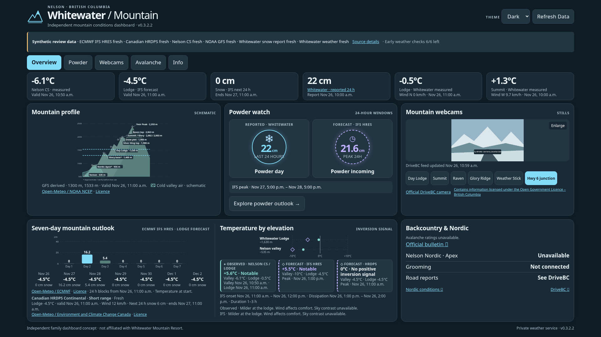
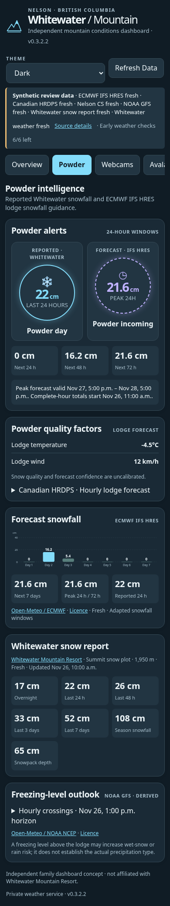
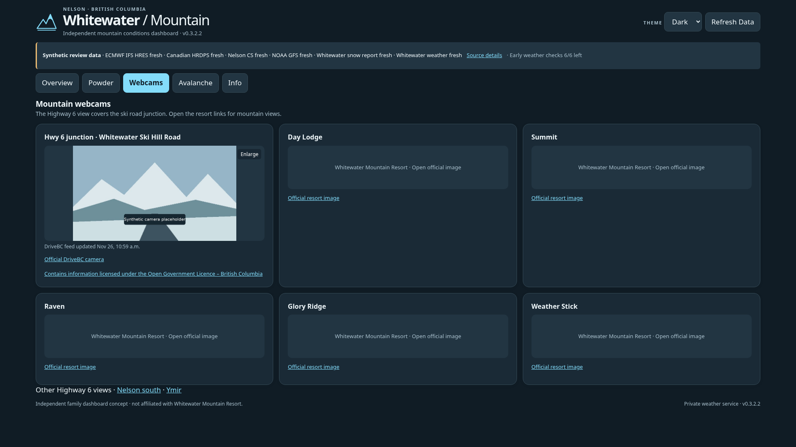

# v0.3.2.2 visual review

All measurements, forecasts and timestamps shown here are synthetic. The highway image is an original illustration. The five resort cards contain links to the provider.

## Wall overview · 1920×1080

The top row shows fresh 24-hour snowfall and separate lodge and summit measurements. Powder Watch shows a blue solid ring for the 22 cm report and a violet dashed ring for the 21.6 cm forecast peak. The elevation plot shows a +5.6°C observed Nelson–lodge difference with both valid times. The IFS and HRDPS forecast comparisons are separate. The GFS freezing levels, two forecast products and highway camera card remain visible.

[Open the full-size wall screenshot](wall-overview.png)

## Phone powder tab · 390 CSS pixels wide

The forecast alerts and hourly guidance appear above the Whitewater report. The report shows 17 cm overnight, 22 cm in 24 hours, 26 cm in 48 hours, 33 cm in three days, 52 cm in seven days, 108 cm season snowfall and 65 cm of snowpack at the summit plot. Its source and report update time appear above the values.

[Open the full-height phone screenshot](phone-powder.png)

## Webcams · 1920×1080

The DriveBC junction card shows the original illustrated placeholder with enlarge control and source time. Day Lodge, Summit, Raven, Glory Ridge and Weather Stick each link to the official still.

[Open the full-size webcam screenshot](webcams.png)

